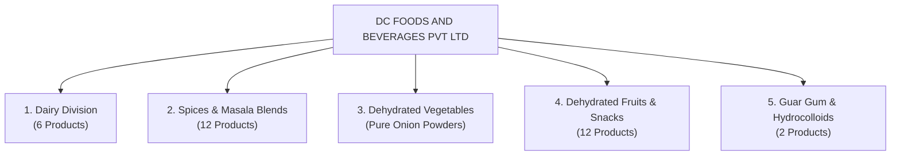

# DC FOODS AND BEVERAGES PVT LTD
### *From Quality Ingredients to Trusted Food Products*

[](https://www.dcfoods.co.in)
[](https://www.dcfoods.co.in)
[](https://maps.google.com)
[](https://www.dcfoods.co.in)

---

## 🏢 Corporate Overview

**DC Foods and Beverages Pvt Ltd** is a premier Indian food processing, FMCG manufacturing, and agro-commodity enterprise based in **Vadodara, Gujarat**. Driven by the philosophy *"Quality That Builds Trust"*, the company delivers high-grade dairy products, authentic ground spices and heritage culinary blends, premium dehydrated fruits, vegetable powders, and hydrocolloid solutions (guar gum) for consumer, HoReCa, and industrial food manufacturing sectors.

The company operates state-of-the-art processing, low-temperature dehydration, and hygienic packaging facilities strategically positioned within Gujarat's premier industrial and logistics corridor.

---

## 📋 Corporate Identity & Legal Credentials

| Parameter | Details |
| :--- | :--- |
| **Legal Entity Name** | **DC FOODS AND BEVERAGES PVT LTD** |
| **Corporate Identification Number (CIN)** | `U10501GJ2025PTC164206` |
| **GSTIN** | `24AALCD7943D1ZM` (State Code 24 - Gujarat) |
| **Industry / Sector** | Food Processing, Dairy, Spices & Agro Commodities (FMCG) |
| **Corporate & Plant Address** | **Shah Industrial Park 6, Gajedra**, Near Waghodiya GIDC, Alva Village Road, Vadodara, Gujarat, India |
| **Primary Enquiries & Sales** | **+91 74869 06477** / **+91 72659 07267** |
| **Official Email Addresses** | `info@dcfoods.co.in` \| `dcfoodsandbeverages@gmail.com` |
| **Official Domains** | [www.dcfoods.co.in](http://www.dcfoods.co.in) \| [www.dcfoodsandbeverages.com](http://www.dcfoodsandbeverages.com) |
| **Brand Motto** | *Quality Products. Strong Margins. Growing Market.* |

---

## 🔍 Organized Digital Asset Directory & Media Index

All 31 original marketing and branding files have been organized, renamed semantically, and categorized under [`public/assets/`](file:///c:/Projects/freelance/dc/public/assets) for direct usage in Next.js (`/assets/...`):

```
public/assets/
├── banners/                                   # Master recruitment & retail displays
│   ├── master-distributor-portrait.jpeg       # Portrait distributor recruitment poster
│   ├── master-distributor-landscape.jpeg      # Landscape distributor recruitment banner
│   ├── master-distributor-make-in-india.jpeg  # Landscape banner with "Make in India" emblem
│   ├── retail-shelf-display-products.jpeg     # Full 3-tier supermarket rack (pouch details)
│   └── retail-shelf-display-weights.jpeg      # Full 3-tier supermarket rack (weight labels)
│
├── products/
│   ├── spices/                                # Spice powders & signature masala blends
│   │   ├── chilli-powder-poster.jpeg          # "Unleash The Heat" creative poster
│   │   ├── chilli-powder-500g-pack.jpeg       # 500g retail pouch in grocery setting
│   │   ├── turmeric-powder-poster.jpeg        # "Unleash The Heat" creative poster
│   │   ├── turmeric-powder-500g-pack.jpeg     # 500g retail pouch with raw turmeric roots
│   │   ├── garam-and-tea-masala-poster.jpeg   # Dual product poster (Garam & Chai Masala)
│   │   ├── garam-masala-500g-pack.jpeg        # 500g pouch + 10-spice ingredient spread
│   │   ├── tea-special-masala-500g-pack.jpeg  # 500g pouch in artisanal tea stall scene
│   │   ├── sev-usal-masala-poster.jpeg        # "Unleash The Aroma" Baroda blend poster
│   │   └── sev-usal-masala-500g-pack.jpeg     # 500g pouch with retailer endorsement
│   │
│   ├── dehydrated-fruits/                     # 100% Natural dried fruit slices & powders
│   │   ├── sun-dried-mango-poster.jpeg        # Commercial oven dehydration poster
│   │   ├── mango-alphonso-200g-pack.jpeg      # 200g Alphonso mango slices retail pack
│   │   ├── orange-slices-200g-pack.jpeg       # 200g dehydrated orange slices pouch
│   │   ├── apple-slices-200g-pack.jpeg        # 200g dehydrated apple crisps pouch
│   │   ├── banana-slices-250g-pack.jpeg       # 250g dehydrated banana rounds pouch
│   │   ├── banana-powder-poster.jpeg          # Pure banana powder & oven drying poster
│   │   └── fruit-slices-assortment-poster.jpeg# Multi-fruit mix (Apple, Apricot, Berries)
│   │
│   └── vegetables/                            # Pure dehydrated vegetable powders
│       ├── onion-powder-200g-pack.jpeg        # 200g retail pouch in pantry setting
│       └── onion-powder-guar-gum-poster.jpeg  # Dual poster (Onion & Guar Gum Powder)
│
├── campaigns/                                 # Out-of-Home (OOH) & 3D promotional renders
│   ├── billboard-vadodara-sev-usal.jpeg       # Vadodara Station Road / Alkapuri hoarding
│   ├── billboard-vadodara-3d-chilli.jpeg      # 3D mortar-pestle installation billboard
│   ├── burj-khalifa-projection-mango.jpeg     # Dubai Burj Khalifa dynamic light projection
│   ├── royal-gold-showroom-turmeric.jpeg      # Royal golden palace dining room concept
│   └── underwater-onion-guargum-ad.jpeg       # Coral reef creative concept
│
├── infographics/                              # Educational manufacturing flowcharts
│   └── mango-production-journey.jpeg         # 5-step farm-to-shelf dehydration process
│
└── videos/                                    # 1080p promotional video spots
    ├── promo-onion-guar-gum-1.mp4             # 8-sec 3D powder explosion animation
    └── promo-onion-guar-gum-2.mp4             # 8-sec floating ingredient animation
```

### Visual Intelligence Scan Summary



---

## 📦 Complete Product Portfolio (33+ Products)

### 1. Dairy Products Division
*Pure, fresh, and hygienically processed dairy essentials adhering to strict cold-chain and pasteurization benchmarks.*

| # | Product Name | Packaging Format | Target Audience & USPs |
| -: | :--- | :--- | :--- |
| 1 | **DC Fresh Milk** | 500ml / 1L Poly Pouches & 1L Premium Glass Bottle | Pasteurized Toned Milk; rich in natural calcium and protein. Daily household and tea vendor staple. |
| 2 | **DC Curd / Dahi** | 200g, 400g, 1kg Sealed Tubs & Bulk Pails | Thick, creamy, and tasty; live active probiotic cultures; zero synthetic thickeners. |
| 3 | **DC Fresh Paneer** | 200g, 500g, 1kg Vacuum Packs | Fresh, ultra-soft malai paneer; high protein yield; retains tenderness on cooking. |
| 4 | **DC Pure Desi Ghee** | 500ml & 1L Glass Jars (Gold Foil Lid) | Danedar texture, rich traditional aroma, pure milk fat, ideal for daily cooking and sweets. |
| 5 | **DC Buttermilk / Chaas** | 250ml & 500ml Bottles / Pouches | Traditional refreshing churned buttermilk, spiced and plain variants for instant hydration. |
| 6 | **DC Flavoured Milk** | 200ml Glass/PET Bottles (Rose & seasonal flavours) | Creamy sweetened dairy beverage with natural extracts; popular among children and youth. |

---

### 2. Spices & Masala Powders Division
*Ground to perfection with cryo-grinding / low-temperature technology to lock in volatile essential oils, colour, and aroma.*

#### A. Pure Ground Spices (Single Spices)
| # | Product Name | Available Pack Sizes | Key Attributes & Slogan |
| -: | :--- | :--- | :--- |
| 7 | **DC Turmeric Powder (Haldi)** | 100g, 200g, 500g, 1kg | High Curcumin content; *“Shudh Rang Shudh Swad - Sehat ka Asli Saathi”*. Zero adulteration. |
| 8 | **DC Chilli Powder (Mirch)** | 100g, 200g, 500g, 1kg | Balanced fiery heat & vibrant natural red colour; stemless ground red chillies. |
| 9 | **DC Coriander Powder (Dhaniya)** | 100g, 200g, 500g | Aromatic green-tinged coriander seeds, coarse-ground for curry texture. |
| 10 | **DC Cumin Powder (Jeera)** | 100g, 200g, 500g | Slow-roasted whole cumin seeds for warm earthy notes. |
| 11 | **DC Black Pepper Powder** | 50g, 100g, 500g | High Piperine Malabar black pepper; sharp pungent aroma. |

#### B. Signature Blended Masalas
| # | Product Name | Available Pack Sizes | Culinary Application & Formulation |
| -: | :--- | :--- | :--- |
| 12 | **DC Sev Usal Special Masala** | **500g, 1kg, 5kg** | **Flagship Specialty:** Authentic Baroda Style Blend formulated for street-food vendors, caterers, and homes. *"Har Kitchen Ki Pehli Pasand"*. |
| 13 | **DC Garam Masala Powder** | 100g, 200g, 500g | Master 10-Spice Blend: Coriander, Cumin, Black Pepper, Cardamom, Clove, Cinnamon, Bay Leaf, Star Anise, Nutmeg, and Mace. |
| 14 | **DC Special Tea Masala (Chai Masala)** | 100g, 200g, 500g | Zesty warming blend of dry ginger (sonth), green cardamom, cloves, cinnamon, and pepper. |
| 15 | **DC Kitchen King Masala** | 100g, 500g | Classic all-in-one seasoning for rich North Indian gravies and paneer dishes. |
| 16 | **DC Sabji Masala** | 100g, 500g | Everyday dry vegetable and stir-fry flavour enhancer. |
| 17 | **DC Chaat Masala** | 100g, 500g | Piquant, tangy blend with black salt, amchur, hing, and roasted cumin. |
| 18 | **DC Kasuri Methi** | 25g, 50g, 100g | High-aroma dried fenugreek leaves from Nagaur; dust-free and crisp. |

---

### 3. Dehydrated Vegetables & Pure Powders
*Natural dehydration preserving 98% of natural flavour, pungency, and shelf stability for 12+ months.*

| # | Product Name | Available Pack Sizes | Applications |
| -: | :--- | :--- | :--- |
| 19 | **DC Dehydrated Onion Powder** | 100g, 200g, 500g, 25kg Bulk Bags | 100% Pure, no added starches or anti-caking chemicals. Ideal for curries, gravies, namkeen seasoning, instant soups, and commercial food batters. |
| 20 | **DC Dehydrated Onion Flakes / Kibbled** | Bulk HoReCa & Institutional Packs | Quick rehydration for burger patties, biryanis, samosa fillings, and industrial seasoning. |

---

### 4. Dehydrated Fruits & Healthy Snacks
*100% Natural, zero added sugar, no chemical preservatives, vacuum-sealed to lock in vitamins and natural sweetness.*

| # | Product Name | Packaging | Nutrition & Selling Highlights |
| -: | :--- | :--- | :--- |
| 21 | **DC Sun-Dried Mango Slices** | 200g Stand-up Zip Pouch | Sourced from premium **Alphonso Mangoes**; intensely sweet, chewy, high in Vitamin A & C. *"Ek Bite... Aur Dil Khush!"* |
| 22 | **DC Dehydrated Orange Slices** | 200g Pouch | Whole citrus slices with rind; high Vitamin C; perfect for snacking, cocktail garnishes, and herbal teas. |
| 23 | **DC Dehydrated Apple Slices** | 200g Pouch | Crispy, naturally sweet, fiber-rich guilt-free healthy snack for school tiffins and fitness enthusiasts. |
| 24 | **DC Dehydrated Banana Slices / Chips** | 250g Pouch | Crisp banana rounds; rich in potassium and healthy energy; oil-free and naturally dried. |
| 25 | **DC Pure Banana Powder** | 200g, 500g Pouch | 100% natural dehydrated banana flour; infant cereal, protein shake booster, and gluten-free baking base. |
| 26 | **DC Dehydrated Kiwi Slices** | 100g, 200g Pouch | Vibrant emerald slices, zesty sweet-tart profile, rich in Vitamin E & antioxidants. |
| 27 | **DC Dehydrated Strawberry** | 100g, 200g Pouch | Whole freeze/heat-dried ripe strawberries; used in muesli, cakes, yogurt toppings, and snacking. |
| 28 | **DC Dehydrated Pineapple Chunks** | 100g, 200g Pouch | Golden tropical pineapple rings/chunks with digestive enzymes and tropical flavour. |
| 29 | **DC Dehydrated Golden Apricot** | 100g, 200g Pouch | Plump sun-dried apricots with soft texture; mineral-dense dry fruit snack. |
| 30 | **DC Dried Cranberries** | 100g, 200g Pouch | Deep ruby tart cranberries, popular for bakery, trail mixes, and salads. |
| 31 | **DC Premium Raisins (Kishmish)** | 200g, 500g Pouch | Golden seedless raisins with uniform size and tender skin. |
| 32 | **DC Black Raisins** | 200g, 500g Pouch | Rich in iron and antioxidants; traditional health tonic ingredient. |
| 33 | **DC Mixed Fruit Medley** | 200g, 500g Pouch | Curated blend of 6+ exotic dehydrated fruits for luxury gifting and breakfast bowls. |

---

### 5. Guar Gum & Hydrocolloids Division
*Natural high-viscosity hydrocolloid derived from Cyamopsis tetragonoloba seeds for food formulation and industrial sectors.*

| # | Product Grade | Available Pack Sizes | Technical Function & End-Use Industries |
| -: | :--- | :--- | :--- |
| 34 | **DC Guar Gum Powder (Food Grade)** | 500g, 1kg Pouches, 25kg Paper Sacks | Premium food stabilizer, texturizer, moisture-retention agent, and thickener. Widely used in ice-creams, sauces, gluten-free bakery products, cheese spreads, and dressings. |
| 35 | **DC Guar Gum Powder (Industrial Grade)** | 500g, 1kg Pouches, 25kg Multi-wall Sacks | High-yield rheology modifier, binder, and film former used in textile printing, papermaking, pharmaceuticals, cosmetics, and industrial fluid control. |

---

## ⚙️ Manufacturing & Quality Assurance

DC Foods and Beverages enforces stringent quality management protocols across its farm-to-shelf lifecycle:

```
[Sustainable Farm Harvesting] 
           │
           ▼
[Precision Cleaning, Peeling & Slicing] (Zero Contamination)
           │
           ▼
[Controlled Low-Temperature Dehydration] (Flavour & Nutrient Lock)
           │
           ▼
[Automated Nitrogen Flushing & Vacuum Sealing] (Tamper-Evident Multi-layer Barrier)
           │
           ▼
[Batch Testing & Dispatch] (Food Safety Compliant)
```

1. **Low-Temperature Moisture Removal**: Retains natural colours, essential volatile oils, natural vitamins, and enzymatic properties without synthetic sulfites or artificial dyes.
2. **Cryo-Grinding Spices**: Prevents thermal degradation of aroma compounds in high-value spices like cardamom, cloves, and mace.
3. **Multi-Barrier Packaging**: Metallic foil laminate pouches with airtight zip seals to provide total barrier resistance against humidity, oxygen, and UV light degradation.
4. **100% Vegetarian & Vegan Range**: Certified pure vegetarian products complying with national and international food standards.

---

## 🤝 Distribution & Channel Partnership Program

DC Foods and Beverages is actively expanding its footprint across India and global export markets. The company invites applications from experienced channel partners:

### Channel Categories Invited
- **Super Stockists & C&F Agents** (State & Regional Levels)
- **FMCG Distributors & Wholesalers** (District & City Tiers)
- **HoReCa Supply Partners** (Dedicated hotel, restaurant, cloud kitchen, and catering distributors)
- **Institutional & Modern Trade Suppliers** (Canteens, corporate supply chains, supermarket chains)
- **Export Partners & International Commodity Traders**

### Strategic Commercial Advantages
* **Superior Gross Margins**: Industry-leading dealer and distributor margin structures ensuring high return on working capital.
* **Exclusive Territorial Rights**: Protected geography allocations preventing channel overlap and price undercut.
* **360° Promotional Backing**: High-impact regional marketing support including outdoor billboard campaigns, retail display racks, point-of-sale danglers, and digital marketing.
* **Flexible Order Quantities**: Scalable SKU configurations tailored for both retail shelf movement and bulk commercial kitchens (e.g., 500g, 1kg, 5kg, and 25kg packs).
* **Timely Supply Chain**: High fill-rates driven by direct manufacturing proximity to Gujarat's major transport arteries (National Highways & Western Freight Corridor).

---

## 📞 Corporate Contact & Trade Inquiries

For distributorship applications, B2B procurement, white-labelling, or institutional orders:

* 📍 **Factory & Office**: Shah Industrial Park 6, Gajedra, Near Waghodiya GIDC, Alva Village Road, Vadodara, Gujarat, India
* 📱 **Direct Call / WhatsApp**: **+91 74869 06477** \| **+91 72659 07267**
* ✉️ **Corporate Email**: [info@dcfoods.co.in](mailto:info@dcfoods.co.in)
* ✉️ **Sales Desk**: [dcfoodsandbeverages@gmail.com](mailto:dcfoodsandbeverages@gmail.com)
* 🌐 **Website**: [www.dcfoods.co.in](http://www.dcfoods.co.in) \| [www.dcfoodsandbeverages.com](http://www.dcfoodsandbeverages.com)

---

> **DC FOODS AND BEVERAGES PVT LTD** — *Taste the Difference. Let's Build a Healthier Future Together.*
